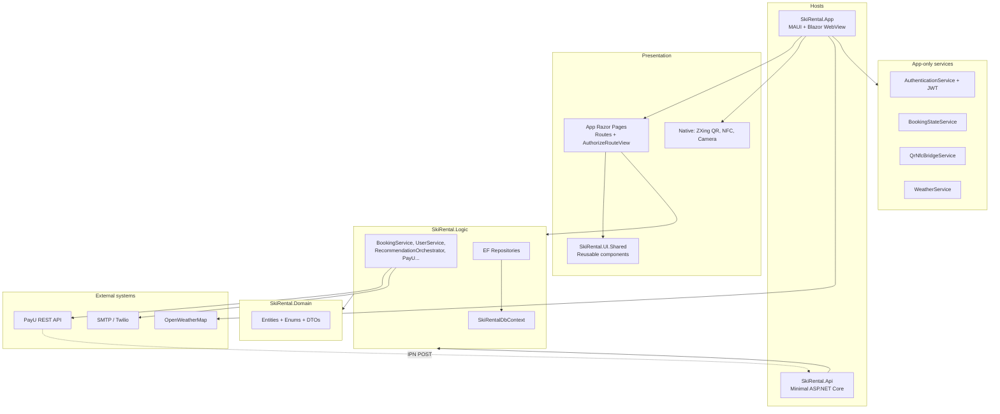

# SkiRental — Solution Architecture

## Purpose

SkiRental is a cross-country ski rental management system. Customers book equipment through an intelligent sizing assistant; workers handle pickup and QR/NFC returns; owners manage fleet, staff, and analytics.

The solution uses **layered architecture** with a shared business core (`Logic` + `Domain`) and two hosts:

1. **SkiRental.App** — primary MAUI Blazor hybrid client (offline-capable SQLite).
2. **SkiRental.Api** — minimal web host for PayU IPN callbacks and shared DB migrations when the mobile app cannot receive webhooks.

The mobile UI does **not** call a full REST API for CRUD; business operations run in-process via DI into `SkiRental.Logic`.

---

## High-level diagram



---

## Layer responsibilities

| Layer | Project | Responsibility |
|-------|---------|----------------|
| Domain | `SkiRental.Domain` | Pure models and enums; no services |
| Application | `SkiRental.Logic` | Business rules, EF persistence, PayU, notifications |
| Shared UI | `SkiRental.UI.Shared` | Blazor components used by the app |
| Client shell | `SkiRental.App` | MAUI host, routing, auth session, device bridges |
| Infrastructure | `SkiRental.Api` | Webhook endpoint, health probe |

---

## Composition root

Both hosts register the same core stack via:

```csharp
services.AddSkiRentalServices(connectionString, configuration: config);
```

Defined in `SkiRental.Logic/ServiceCollectionExtensions.cs`. It registers:

- `SkiRentalDbContext` (SQLite if connection contains `Data Source=` or `.db`, else SQL Server)
- `IUserRepository`, `IEquipmentRepository`, `IRentalRepository`
- `EquipmentMathService`, `BookingService`, `AnalyticsService`, `UserService`
- `RecommendationOrchestrator`, `GearSwapService`, `RentalRulesService`
- `NotificationService`, `NotificationInboxService`, `AnalyticsExportService`

**PayU** (`IPaymentProvider` / `PayUPaymentProvider`) is registered separately in each host with `IHttpClientFactory` (not inside `AddSkiRentalServices`).

---

## Rental lifecycle (equipment status)

Correct flow avoids locking inventory when payment fails or the customer no-shows:

| Stage | `RentalStatus` | `EquipmentStatus` | Trigger |
|-------|----------------|-------------------|---------|
| Reservation created | `Pending` | `Reserved` | `BookingService.CreateBookingAsync` |
| Customer picks up gear | `Active` | `Rented` | `BookingService.ActivateRentalAsync` |
| Return scanned | `Completed` | `Available` | `BookingService.ProcessReturnAsync` |
| Cancelled | `Cancelled` | `Available` | `BookingService.CancelBookingAsync` |

`Reserved` is a distinct status (not present in early docs that only listed Available/Rented).

---

## Customer booking flow (page-based)

The app uses a **multi-page wizard** with scoped `BookingStateService` (not only `BookingWizard.razor`):

```
/calendar-booking
    → /recommendation-loading
    → /gear-review  (or /no-match)
    → /payment
    → /confirmation
```

Legacy route `/booking` still exists and can host the shared `BookingWizard` component.

---

## Staff return flow (QR / NFC)

1. Worker opens scanner from `MainPage` (ZXing overlay) or `EmployeePage` / `QrScannerPanel`.
2. Native layer reads QR → JS `skiRentalBridge.dispatchQrCode` → Blazor.
3. `BookingService.ProcessReturnAsync` validates QR, records condition, captures payment if pre-authorized, frees equipment.

NFC can write rental id to a tag via `QrNfcBridgeService` (Plugin.NFC).

---

## Authentication and authorization

- Credentials: `AppUser` in DB, **BCrypt** hashes (`UserService`).
- Session: `AuthenticationService` (singleton) + optional JWT (`JwtTokenService`) for “remember me”.
- UI guard: `AuthorizeRouteView.razor` — not ASP.NET `[Authorize]` middleware on the API.

| Route prefix | Minimum role |
|--------------|--------------|
| `/`, `/login`, `/register` | Public |
| `/booking`, `/profile`, `/my-rentals`, … | Any authenticated user |
| `/employee`, `/manage-orders`, `/manage-customers`, `/analytics` | Worker or Owner |
| `/equipment-management`, `/staff-management` | Owner only |

See [Authentication-System.md](Authentication-System.md).

---

## Payments (PayU)

| Method | Use case |
|--------|----------|
| Spot (`PaymentMethod.Spot`) | Pay at desk — no PayU call |
| Online BLIK | `InitiateBlikPayment` |
| Pre-auth + capture | Hold on booking, capture on return |

`NotifyUrl` in config points to `SkiRental.Api` `POST /api/payu/notify`. The handler marks pre-authorized active rentals as `Paid` when body contains `COMPLETED` (simplified; production should verify PayU signature).

---

## Database strategy

| Host | Connection |
|------|------------|
| App | `{AppDataDirectory}/SkiRental.db` (SQLite) |
| Api | `appsettings.json` → `ConnectionStrings:SkiRentalSqlite` |
| Tests | Moq repositories or `useInMemory: true` |

Migrations live in `SkiRental.Logic/Migrations/`. Applied at startup via `Database.Migrate()` / `ApplyMigrationsAsync()`.

---

## Equipment categories in production

The shop rents **Skis, Poles, Boots** only (`RentalEquipmentCategories.All`). Enum still includes `Gloves` and `Helmet` for schema compatibility; startup removes legacy seed rows for those categories.

---

## Configuration sections (`appsettings.json`)

| Section | Bound type | Used by |
|---------|------------|---------|
| `ConnectionStrings` | — | App, Api |
| `Jwt` | `JwtOptions` | App |
| `PayU` | `PayUOptions` | App, Api, `PayUPaymentProvider` |
| `OpenWeather` | — | `WeatherService` |
| `Email`, `Sms` | — | `NotificationService` |
| `SkiRental` | `SkiRentalOptions` | `RentalRulesService`, season limits |
| `Logging` | — | All hosts |

---

## Build and deploy notes

- **App:** Multi-target MAUI (`android`, `ios`, `maccatalyst`, `windows10.0.19041.0`). `appsettings.json` is an **EmbeddedResource**.
- **Api:** Run behind HTTPS with public URL for PayU `NotifyUrl`.
- **EF tools:** Use `SkiRentalDbContextFactory` with startup project App or Api.

---

## Related documents

- Per-project: [SkiRental.Domain.md](SkiRental.Domain.md), [SkiRental.Logic.md](SkiRental.Logic.md), [SkiRental.App.md](SkiRental.App.md), [SkiRental.UI.Shared.md](SkiRental.UI.Shared.md), [SkiRental.Api.md](SkiRental.Api.md), [SkiRental.Tests.md](SkiRental.Tests.md)
- [Database-Schema.md](Database-Schema.md)
- [API-Documentation.md](API-Documentation.md) — interface and component reference
