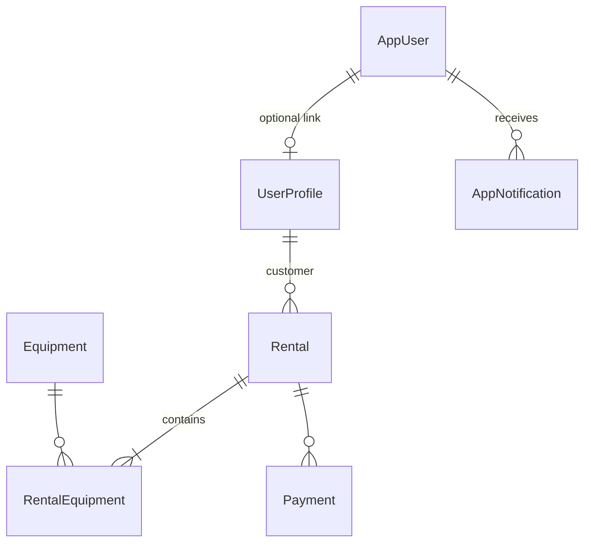

# SkiRental.Domain — Domain Layer

## Overview

**SkiRental.Domain** is a `net9.0` class library that defines the vocabulary of the ski rental system: persistent entities, enumerations, and data transfer objects for recommendations and analytics. It has **no application services**, no EF `DbContext`, and no UI references.

Other projects depend on it; it depends only on NuGet packages needed for annotations (`Microsoft.EntityFrameworkCore`, `System.ComponentModel.Annotations`).

| Property | Value |
|----------|-------|
| SDK | `Microsoft.NET.Sdk` |
| Target | `net9.0` |
| Namespace root | `SkiRental.Domain` |

---

## Project structure

```
SkiRental.Domain/
├── Enums/
│   ├── Enums.cs                      # SkillLevel, SkiStyle, statuses, PaymentMethod
│   └── RentalEquipmentCategories.cs  # Shop-offered categories (Skis, Poles, Boots)
├── Models/
│   ├── Equipment.cs
│   ├── UserProfile.cs
│   ├── Rental.cs                     # Rental, RentalEquipment, Payment
│   ├── AppUser.cs                    # AppUser + AppRole enum
│   ├── AppNotification.cs
│   ├── EquipmentRecommendation.cs    # Legacy/summary recommendation DTOs
│   ├── RecommendationResult.cs       # Multi-step flow: GearSelection, SwapOption, NoMatchReason
│   └── GearPosition.cs               # GearPosition enum (UI/layout helper)
└── SkiRental.Domain.csproj
```

---

## Design principles

1. **Separation of auth and profile** — `AppUser` holds credentials and role; `UserProfile` holds anthropometrics. A walk-in customer can have a profile without login.
2. **Explicit rental aggregate** — `Rental` is the root; `RentalEquipment` links equipment with condition scores; `Payment` records transactions.
3. **Status enums over magic strings** — Equipment and rental states are enums (except `AppUser.Role` stored as string for readable SQLite rows).
4. **NotMapped computed properties** — BMI, age, and aggregates on `UserProfile` are calculated in the entity, not stored.

---

## Enumerations (`Enums/Enums.cs`)

### SkillLevel

| Value | Meaning |
|-------|---------|
| `Beginner` | Novice — softer flex, longer ski offset tolerance |
| `Intermediate` | Default recreational skier |
| `Advanced` | Performance-oriented sizing |
| `Expert` | Racing-level stiffness targets |

### SkiStyle

| Value | Meaning | Sizing impact |
|-------|---------|---------------|
| `Classic` | Traditional parallel tracks | Longer skis, poles ≈ 0.85 × height |
| `Skate` | Skating technique | Shorter skis, poles ≈ 0.90 × height |
| `Combi` | Universal / combination | Versatile equipment matching |

### EquipmentStatus

| Value | Meaning |
|-------|---------|
| `Available` | Can be reserved |
| `Reserved` | Locked for a `Pending` rental |
| `Rented` | Issued to customer (`Active` rental) |
| `Maintenance` | Not rentable |
| `Retired` | Removed from active fleet |

### EquipmentCategory

Full enum includes `Skis`, `Poles`, `Boots`, `Gloves`, `Helmet`. **Operational rental set** is only the first three — see `RentalEquipmentCategories.All`.

### RentalStatus

| Value | Meaning |
|-------|---------|
| `Pending` | Booked, not yet picked up |
| `Active` | Equipment with customer |
| `Completed` | Returned |
| `Cancelled` | Aborted before or without pickup |
| `Overdue` | Past `EndTime` while still active |

### PaymentStatus

`Unpaid` → `Preauthorized` → `Paid` | `Refunded` | `Failed`

### PaymentMethod

| Value | Meaning |
|-------|---------|
| `Spot` | Pay at rental desk |
| `Online` | PayU / BLIK |

---

## RentalEquipmentCategories

```csharp
public static readonly EquipmentCategory[] All =
    [ Skis, Poles, Boots ];
```

Used by recommendation orchestration and UI to iterate categories the shop actually stocks.

---

## Entities

### Equipment (`Models/Equipment.cs`)

Represents one inventory unit (skis, poles, or boots).

| Property | Type | Notes |
|----------|------|-------|
| `Id` | `int` | PK |
| `SerialNumber` | `string` | Unique, max 100 |
| `Brand`, `Model` | `string` | Display / admin |
| `Category` | `EquipmentCategory` | |
| `Size` | `decimal` | cm or EU shoe size, precision (5,1) |
| `Stiffness` | `int?` | Flex index for skis |
| `Status` | `EquipmentStatus` | Lifecycle |
| `CompatibleStyle` | `SkiStyle?` | Optional style filter |
| `YearOfProduction` | `int` | |
| `DailyRate` | `decimal` | PLN per day |
| `TotalRentalDays` | `int` | Analytics counter |
| `ImagePath` | `string?` | |
| `LastMaintenanceDate`, `MaintenanceNotes` | | Service history |

**Navigation:** `RentalEquipments` → join rows.

---

### UserProfile (`Models/UserProfile.cs`)

Customer physical data and preferences for the intelligent assistant.

| Property | Type | Constraints / notes |
|----------|------|---------------------|
| `Height` | `int` | cm, 100–250 |
| `Weight` | `decimal` | kg |
| `ShoeSize` | `int` | EU 30–55 |
| `SkillLevel` | `SkillLevel` | |
| `PreferredStyle` | `SkiStyle` | |
| `Email`, `PhoneNumber` | `string?` | Contact |
| `EmailNotificationsEnabled`, `SmsNotificationsEnabled` | `bool` | |
| `CreatedAt`, `UpdatedAt` | `DateTime` | Audit |

**Computed (`[NotMapped]`):**

- `Bmi` — `Weight / (Height/100)²`
- `IsBmiNormal`, `IsUnderweight`, `IsOverweight`
- `Age` from `DateOfBirth`
- `TotalRentalsCount`, `LastRentalDate`, `TotalSpent`, `FavoriteEquipmentCategory` (when rentals loaded)

**Navigation:** `Rentals`

---

### AppUser (`Models/AppUser.cs`)

Authentication account (separate from profile).

| Property | Type | Notes |
|----------|------|-------|
| `Username` | `string` | Unique, compared case-insensitively in Logic |
| `PasswordHash` | `string` | BCrypt, work factor 12 |
| `Role` | `string` | Persisted; use `AppRole` property |
| `UserProfileId` | `int?` | Optional link to profile |
| `IsLocked`, `FailedLoginAttempts`, `LockoutEnd` | | Brute-force protection |
| `CreatedAt`, `LastLoginAt` | | Audit |

**`AppRole` enum (privilege ascending):**

| Role | Level | Typical access |
|------|-------|----------------|
| `Customer` | 0 | Book, profile, my rentals |
| `Worker` | 1 | QR returns, orders, customers, analytics |
| `Owner` | 2 | Equipment + staff management |

Helper: `IsCurrentlyLocked` considers `LockoutEnd`.

---

### Rental aggregate (`Models/Rental.cs`)

#### Rental

| Property | Type | Notes |
|----------|------|-------|
| `CustomerProfileId` | `int` | FK to `UserProfile` |
| `EmployeeId` | `int?` | Staff who processed return |
| `StartTime`, `EndTime` | `DateTime` | Planned window |
| `ActualReturnTime` | `DateTime?` | |
| `QrCode` | `string?` | Unique return token |
| `NfcTagData` | `string?` | Base64 payload |
| `IsPreauthorized` | `bool` | PayU hold |
| `PaymentStatus` | `PaymentStatus` | |
| `TotalAmount`, `PreauthorizedAmount` | `decimal` | |
| `PayUOrderId` | `string?` | External order id |
| `Status` | `RentalStatus` | |
| `Notes` | `string?` | |

**Computed:** `PlannedDurationHours` = `(EndTime - StartTime).TotalHours`

**Navigation:** `Customer`, `RentalEquipments`, `Payments`

#### RentalEquipment (join)

| Property | Type | Notes |
|----------|------|-------|
| `RentalId`, `EquipmentId` | | Composite key |
| `ConditionAtPickup` | `int` | 1–5, default 5 |
| `ConditionAtReturn` | `int?` | 1–5 at return |

#### Payment

| Property | Type | Notes |
|----------|------|-------|
| `RentalId` | `int` | |
| `Amount` | `decimal` | |
| `Status` | `PaymentStatus` | |
| `ExternalTransactionId` | `string?` | PayU id |
| `PaymentMethod` | `string?` | e.g. BLIK |
| `ProviderResponse` | `string?` | Raw JSON snippet |

---

### AppNotification (`Models/AppNotification.cs`)

In-app inbox messages (persisted, read via `NotificationInboxService`).

Typical fields: `UserId`, `Title`, `Body`, `IsRead`, `CreatedAt`, optional `RentalId` / category for deep links.

---

## Recommendation DTOs

### EquipmentSelectionParameters (`EquipmentRecommendation.cs`)

Input to math and orchestration services:

- `Height`, `Weight`, `ShoeSize`
- `Style` (`SkiStyle`)
- `SkillLevel`
- Optional date range for pricing

### EquipmentRecommendation

Legacy/single-shot result: recommended lengths, stiffness, matched `Equipment` lists, explanation text.

### RecommendationResult (`RecommendationResult.cs`)

Used by the **new page-based booking flow**:

| Member | Purpose |
|--------|---------|
| `GearSelections` | Per-category chosen equipment + scores |
| `NoMatchReason` | Why a category could not be filled |
| `CanProceed` | Whether booking can continue |
| `Explanation` | Human-readable algorithm summary |

### GearSelection, SwapOption

- `GearSelection` — category, equipment id, size delta, explanation
- `SwapOption` — alternative equipment within tolerance for `IGearSwapService`

### UtilizationReport

Analytics DTO: rented hours, season hours, utilization rate, revenue (consumed by `AnalyticsService` / dashboard).

---

## Entity relationship diagram



---

## Validation and annotations

- `[Required]`, `[MaxLength]`, `[Range]` on critical fields
- `[Table("...")]` for explicit table names (`AppUsers`, etc.)
- `[NotMapped]` for computed properties and `AppRole` accessor
- Financial decimals configured in `SkiRentalDbContext` (Logic), not in Domain

---

## Dependencies

**Project references:** none  

**NuGet:**

- `Microsoft.EntityFrameworkCore` (annotations / tooling compatibility)
- `System.ComponentModel.Annotations`

---

## Usage by other layers

| Consumer | Usage |
|----------|-------|
| `SkiRental.Logic` | EF mappings, services, repositories |
| `SkiRental.UI.Shared` | Component parameters and display |
| `SkiRental.App` | Pages, auth role checks |
| `SkiRental.Tests` | Test fixtures and assertions |

---

## What does not belong in Domain

- Repository interfaces → `SkiRental.Logic.Interfaces`
- PayU HTTP calls → `PayUPaymentProvider`
- BCrypt hashing → `UserService`
- Blazor components → `SkiRental.UI.Shared` / `SkiRental.App`

Keeping these out preserves a stable, testable domain model.

---

## See also

- [SkiRental.Logic.md](SkiRental.Logic.md) — business rules using these types
- [Database-Schema.md](Database-Schema.md) — physical schema and indexes
- [Architecture.md](Architecture.md) — rental status workflow
